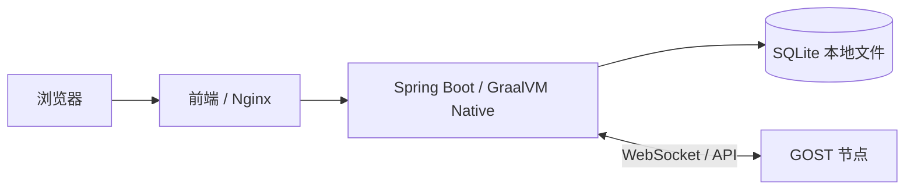

# Flux Panel

**轻量级 GOST 转发管理面板 · SQLite · GraalVM Native Image**

Flux Panel 是基于 [GOST](https://github.com/go-gost/gost) 的网络转发管理面板，提供节点、隧道、转发规则、用户及流量配额的统一管理。

本仓库基于 [bqlpfy/flux-panel](https://github.com/bqlpfy/flux-panel) 进行维护和改造，重点优化低配置服务器的部署成本、运行资源占用和数据库迁移体验。

[](LICENSE)
[](https://github.com/heroixinu/flux-panel/actions/workflows/native-image.yml)
[](https://github.com/heroixinu/flux-panel/actions/workflows/docker-build.yml)

> 当前轻量化版本在 `codex/sqlite-default` 分支维护。部署前请确认对应代码的 CI 已通过，且 GHCR 镜像已发布。当前构建目标为 Linux AMD64（x86_64）。

## 功能特性

- TCP / UDP 端口转发与隧道转发，支持多节点统一管理。
- 用户及隧道级流量配额、转发数量限制、指定用户的隧道限速。
- 单向 / 双向流量计费、流量倍率及定时重置、统计展示。
- 多种转发策略、节点状态监控及转发诊断。
- WebSocket 节点通信、JWT 鉴权；不再依赖图形验证码。
- 默认 SQLite 数据库，免独立数据库服务，自动初始化。
- 默认 GraalVM Native 后端，同时提供 JVM 镜像及 PostgreSQL 数据库支持。
- 支持直接从 MySQL / PostgreSQL 历史备份自动迁移至 SQLite，以及一致性在线备份和离线恢复。

## 部署架构



默认部署仅需前端和后端两个容器。SQLite 与后端运行在同一进程中，无需启动 MySQL、PostgreSQL 或额外的迁移服务，适合个人及小规模、低内存服务器。

| 组件 | 默认方案 | 可选方案 |
| --- | --- | --- |
| 后端 | GraalVM Native Image | Java 21 JVM |
| 数据库 | SQLite | PostgreSQL 16 / 外部 PostgreSQL |
| 前端 | React + Vite + Nginx | — |
| 节点 | Go / GOST | — |
| 架构 | Linux AMD64 | 当前不构建 ARM 镜像 |

## 快速安装

### 1. 一键安装面板

准备一台 Linux AMD64 服务器，安装 Docker 与 Docker Compose。在新建的部署目录执行：

```bash
mkdir -p flux-panel && cd flux-panel
curl -fsSL https://raw.githubusercontent.com/heroixinu/flux-panel/codex/sqlite-default/panel_install.sh -o panel_install.sh
chmod +x panel_install.sh
./panel_install.sh
```

选择 **1. 安装面板**，根据提示设置端口。脚本将检测 IPv6 支持情况，并下载对应的 Compose 配置，生成 JWT 密钥。

| 项目 | 默认值 |
| --- | --- |
| 面板访问地址 | `http://服务器IP:6366` |
| 后端 API 端口 | `6365` |
| 初始管理员账号 | `admin_user` |
| 初始管理员密码 | `admin_user` |

首次登录后请立即修改默认账号及密码。迁移安装使用历史数据库内的管理员凭据，而非上述初始密码。

### 2. Docker Compose / 1Panel 手动部署

适合需要自行管理端口、数据目录或反向代理的场景。

```bash
mkdir -p flux-panel && cd flux-panel
umask 077
mkdir -p data import
curl -fsSL https://raw.githubusercontent.com/heroixinu/flux-panel/codex/sqlite-default/docker-compose-v4.yml -o docker-compose.yml

cat > .env <<EOF
FRONTEND_PORT=6366
BACKEND_PORT=6365
JWT_SECRET=$(openssl rand -hex 32)
IMAGE_TAG=sqlite-default
BACKEND_IMAGE_TAG=sqlite-native
DB_IMPORT_ENABLED=false
EOF

docker compose pull
docker compose up -d
docker compose ps
```

如需 Docker IPv6 网络，使用 [docker-compose-v6.yml](docker-compose-v6.yml) 替换 IPv4 配置，并确保宿主机 Docker 支持 IPv6。

在 1Panel 中可通过「容器 → 编排」使用相同的 Compose 和环境变量。请确保持久化目录位于本地磁盘。通过反向代理对外提供 HTTPS 时，应同步支持节点通信所需的 WebSocket，并按需开放后端访问。

### 3. 安装 GOST 节点

在管理面板的「节点监控」创建节点，点击 **安装**，将生成的命令复制到 Linux AMD64 节点服务器执行。命令会自动携带面板地址和节点密钥，从本仓库的 SQLite 预览 Release 下载安装脚本及节点二进制，校验 SHA256 后安装。

也可手动下载并运行交互式安装器：

```bash
curl -fsSL https://github.com/heroixinu/flux-panel/releases/download/sqlite-default/install.sh -o install.sh
chmod +x install.sh
./install.sh
```

[SQLite 节点预览 Release](https://github.com/heroixinu/flux-panel/releases/tag/sqlite-default) 随本分支 CI 更新，不是正式版本。正式版本镜像则使用对应 Git 标签的 Release；可在后端环境变量中通过 `FLUX_NODE_RELEASE_REPO` 和 `FLUX_NODE_RELEASE_TAG` 覆盖安装命令的发布来源。请确保指定的 Release 同时包含 `install.sh`、`gost-amd64` 和 `gost-amd64.sha256`。当前仅发布 Linux AMD64 节点。


## 镜像与运行模式

镜像由 GitHub Actions 构建并发布到 GHCR：

| 镜像 | 标签 | 用途 |
| --- | --- | --- |
| `ghcr.io/heroixinu/flux-panel-backend` | `sqlite-native` | 默认后端，Native Image |
| `ghcr.io/heroixinu/flux-panel-backend` | `sqlite-jvm` | JVM 后端，兼容性与排障 |
| `ghcr.io/heroixinu/flux-panel-frontend` | `sqlite-default` | 前端 |

这些分支标签随通过验证的构建更新，并非不可变版本号。生产部署建议使用已验证的版本标签或镜像摘要，避免混用不同版本的前后端。

**切换至 JVM：** 将 `.env` 中的 `BACKEND_IMAGE_TAG` 改为 `sqlite-jvm` 后重新拉取并创建后端容器即可，SQLite 数据文件保持不变。

**使用 PostgreSQL：** 新装时可运行 `FLUX_DB_TYPE=postgresql ./panel_install.sh`，或使用 [IPv4 PostgreSQL Compose](docker-compose-postgresql-v4.yml) / [IPv6 PostgreSQL Compose](docker-compose-postgresql-v6.yml)，同时保留 [数据库结构](gost-schema.sql)、[初始化数据](gost.sql)，配置 `DB_NAME`、`DB_USER`、`DB_PASSWORD` 及上述镜像标签。外部 PostgreSQL 则通过后端环境变量连接。

已有 PostgreSQL 部署仅升级兼容后端镜像时，会保留原有数据库类型；不会因为新版默认使用 SQLite 就自动切换数据源。

## 历史数据库迁移

支持在后端容器首次启动时，将兼容 Flux Panel 的旧版数据库备份自动导入新版 SQLite。不需要启动源数据库服务，不直接执行备份中的 SQL。

| 来源 | 支持的备份格式 |
| --- | --- |
| MySQL | mysqldump SQL（含多行 INSERT） |
| PostgreSQL | pg_dump 纯文本 SQL（COPY / INSERT） |
| PostgreSQL | pg_dump 自定义归档（PGDMP，由 pg_restore 解码） |
| 压缩 | 原始备份或 gzip 压缩备份（包括 .sql.gz） |

### 自动导入

1. 停止旧面板写入，导出最终数据库备份，保留原配置、JWT 密钥及旧数据库。
2. 按手动部署方式准备新目录与 Compose，**暂不启动后端**，确保 `data/` 中没有 SQLite 文件及其 WAL / SHM。
3. 将备份放入 `import/`，修改 `.env`（使用原部署的 JWT_SECRET）：

```dotenv
DB_IMPORT_ENABLED=true
DB_IMPORT_FILE=backup.sql.gz
```

4. 启动新面板并查看日志：

```bash
docker compose up -d
docker compose logs -f backend
```

出现 `Legacy import complete` 后，检查管理员登录、节点连接、隧道、转发规则及流量记录。确认正常后，将 `DB_IMPORT_ENABLED` 改回 `false`，删除 `DB_IMPORT_FILE` 配置，再执行 `docker compose up -d`。

导入器会自动识别数据库及压缩格式，校验八张业务表和数据字段，保留主键、序列高水位及业务数据，在临时 SQLite 文件通过完整性检查后原子发布。相同备份重复启动时跳过导入；不同备份、已有无关 SQLite 文件或损坏的备份将阻止启动，而不是覆盖数据或初始化空库。原始备份不会被删除或修改。

该能力适用于兼容的 Flux Panel 数据库结构，不是通用 SQL 转换工具。更详细的格式限制及回滚流程见 [SQLite 运维与迁移文档](docs/sqlite-operations.md)。

## 环境变量

### SQLite / 通用配置

| 变量 | 默认值或说明 |
| --- | --- |
| `JWT_SECRET` | 必填；生成强随机密钥并持久保存 |
| `FRONTEND_PORT` | Compose 前端映射端口，安装器默认 6366 |
| `BACKEND_PORT` | Compose 后端映射端口，安装器默认 6365 |
| `IMAGE_TAG` | SQLite Compose 默认 `sqlite-default` |
| `BACKEND_IMAGE_TAG` | SQLite Compose 默认 `sqlite-native` |
| `DB_TYPE` | `sqlite`；也可选 `postgresql` |
| `DB_PATH` | 容器内 `/app/data/flux.db` |
| `DB_SQL_INIT_MODE` | `always`；启动时初始化缺失的表 |
| `LOG_DIR` | Compose 中为 `/app/logs` |

### 历史备份导入

| 变量 | 默认值或说明 |
| --- | --- |
| `DB_IMPORT_ENABLED` | `false`，显式开启才导入 |
| `DB_IMPORT_DIR` | `/app/import` |
| `DB_IMPORT_FILE` | 文件名；仅有一个候选文件时可省略 |
| `DB_IMPORT_MAX_BYTES` | `1073741824`（解压/解码大小上限，1 GiB） |

Compose 已映射 `./import:/app/import:ro` 和 `./data:/app/data`。自定义目录、数据库路径或 SQL 初始化方式时，需要相应修改 Compose 传入后端的环境变量及挂载；仅修改 .env 中未被 Compose 引用的变量不会改变容器配置。

### PostgreSQL 连接

可选变量：`DB_TYPE=postgresql`、`DB_HOST`、`DB_PORT`（默认 5432）、`DB_NAME`、`DB_USER`、`DB_PASSWORD`。兼容旧版通过 `DB_HOST` 自动选择 PostgreSQL 的部署方式。开启历史备份导入时不要同时传入旧数据库连接变量。

## 数据持久化与运维

```text
flux-panel/
├── docker-compose.yml
├── .env
├── data/                  # 持久化 SQLite 数据目录
│   └── flux.db
└── import/                # 历史备份导入目录（容器内只读）
```

SQLite 默认采用 WAL、单连接池、10 秒锁等待超时和 FULL 同步模式，优先保证数据可靠性。仅建议单后端实例使用 SQLite，不要将数据库文件放在 NFS / SMB 等网络文件系统上。多实例或高并发写入场景建议使用 PostgreSQL。

### 日常管理

```bash
docker compose ps
docker compose logs -f backend
docker compose pull
docker compose up -d
docker compose down
```

更新前请先备份，并确认镜像版本兼容。也可重新下载一键安装脚本，选择 **2. 更新面板**、**3. 卸载面板** 或 **4. 导出备份**。普通更新保留既有数据库类型，卸载保留数据库目录/卷。

### 备份与恢复

建议通过安装脚本的 **4. 导出备份** 功能进行 SQLite 在线一致性备份（自动执行完整性检查），或针对 PostgreSQL 导出 pg_dump 归档。

不要直接复制运行中的 `flux.db` 单文件作为备份，WAL 中可能仍有已提交的数据。恢复时先停止后端，校验备份，将旧数据目录整体移出后再恢复。请同时妥善备份 `.env`，尤其是 JWT_SECRET。完整步骤见 [SQLite 运维与迁移文档](docs/sqlite-operations.md)。

## 开发与验证

- [springboot-backend](springboot-backend)：Java 21、Spring Boot、MyBatis-Plus、SQLite JDBC / PostgreSQL JDBC、GraalVM Native。
- [vite-frontend](vite-frontend)：React、TypeScript、Vite。
- [go-gost](go-gost)：GOST 节点。
- [scripts](scripts)：数据库迁移、HTTP / WebSocket 回归与容器测试。

CI 覆盖 JVM 与 Native 两种运行时、SQLite 与 PostgreSQL 两种数据库、自动初始化、生成主键、流量并发、定时任务、容器重启、备份恢复、历史数据库迁移及启动导入。实际启动时间、RSS、容器内存及组合部署内存指标可在 [Native Image CI](https://github.com/heroixinu/flux-panel/actions/workflows/native-image.yml) 的测试报告中查看。

## 相关文档

- [SQLite 部署、备份、迁移与恢复](docs/sqlite-operations.md)
- [GraalVM Native 运维说明](docs/graalvm-native-operations.md)
- [PostgreSQL 运维与历史迁移](docs/postgresql-operations.md)
- [GitHub Actions](https://github.com/heroixinu/flux-panel/actions)
- [Releases](https://github.com/heroixinu/flux-panel/releases)

## 许可证与致谢

本项目采用 [Apache License 2.0](LICENSE)，感谢原项目 [Flux Panel](https://github.com/bqlpfy/flux-panel) 及 [go-gost/gost](https://github.com/go-gost/gost)、[go-gost/x](https://github.com/go-gost/x) 的开源贡献。

请仅在合法且获得授权的网络环境中使用本项目。部署者应自行负责访问控制、凭据保护、数据备份和合规使用。本项目按许可证条款提供，不附带任何额外担保。

## Passkey 登录（可选）

支持基于 WebAuthn 的 Passkey 登录，可在完成用户凭证绑定和验证后关闭全局账号密码登录。默认不改变已有部署行为。

在 .env 中配置：

```dotenv
PASSKEY_ENABLED=true
PASSKEY_ORIGIN=https://panel.example.com
PASSKEY_RECOVERY_PASSWORD_LOGIN=false
```

同时升级前后端并重建容器。登录后从「Passkey 与登录安全」注册凭证和配置登录策略。使用浏览器实际访问的 HTTPS 域名，禁止将内部后端地址当作 Origin。

详细操作、应急恢复与迁移注意事项见 [Passkey 运维指南](docs/passkey-operations.md)。
